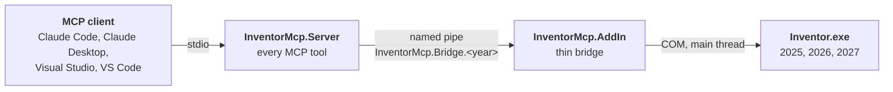

# Architecture

Why this tool is built the way it is.
For installing and using it, see `Setup-and-Usage-Guide.md`.

## Shape



The client starts the server (`net10.0`) through `dotnet tool exec` from a local feed. Each Inventor release has its
own pipe, open only to the current Windows user. The add-in targets `net8.0-windows` on 2025 and 2026, and
`net10.0-windows` on 2027. It holds only the pipe listener, the dispatch, and the marshaling to Inventor's main thread.

| Project | Purpose |
| --- | --- |
| `InventorMcp.Contracts` | The wire contract. Holds no Inventor interop, so the server builds without Inventor installed. |
| `InventorMcp.AddIn` | Runs inside Inventor. Owns the pipe listener and main thread dispatch only. |
| `InventorMcp.AddIn.Loader` | Inventor 2025 and 2026 only. The one assembly loaded into the default context; loads the add-in from `App\` in isolation. |
| `InventorMcp.Server` | Owns every tool. |
| `Libs/Inventor/<version>` | The vendored interop assembly per release, so a machine without Inventor can still build. |

## Decisions

### Two processes rather than one

Inventor's API is in-process COM, not a service, so something has to run inside `Inventor.exe`.
The question was whether the MCP server should run there too.

It does not, because **changing the add-in requires closing Inventor**.
The tool surface changes constantly; the bridge stabilised within a day.
Keeping the tools in a separate process means most work needs no CAD restart.

It also means the MCP connection survives Inventor closing and reopening.
Claude gets a readable "Inventor is not running" result instead of a dead server.

### A named pipe rather than a local HTTP port

The pipe is kernel backed, needs no port, and `PipeSecurity` restricts it to the account that started Inventor.
A loopback TCP port is reachable by every process and every logged on user unless a shared secret is added.

That matters here because the endpoint can execute arbitrary code inside the CAD process.

The pipe name is fixed for a release (`InventorMcp.Bridge.<year>`, ex. `InventorMcp.Bridge.2026`), so the server
connects with no discovery step. Inventor 2025, 2026 and 2027 can run at the same time, each with its own pipe.
A second Inventor of the same release cannot claim its pipe, and logs the conflict rather than competing.
The add-in reads the release from `Application.SoftwareVersion`, not from a build constant, so a wrong build input
cannot give a pipe name that does not match the process.

The add-in serves up to 16 connections (`MaxPipeInstances`), one for each server. Each MCP client starts its own
server and Claude Desktop starts two, so four clients already made six to seven servers. The ACL admits only the
current user, so the limit guards resources, not access. With every instance in use, the accept loop waits for a
connection to end before it creates another pipe, and it pauses 1 s after any failed accept.

The limit was four until 2026-09-23. Then, with four clients connected on Inventor 2025, creating a fifth instance
failed at once with "All pipe instances are busy", and the loop retried with no pause: 466,356 log lines in about
4.5 minutes, up to 2,000 a second, and a 40 MB `addin.log`. A fifth server meanwhile timed out and reported
`inventor-not-running`, which told the model to start Inventor although it was running. After the fix, 16
connections each connected in about 40 ms, the 17th and 18th got a readable message, and the loop wrote no lines.

A server that cannot connect within 3 s keeps the code `inventor-not-running`, because `inventor_start` and
`inventor_session` with `waitSeconds` poll on it while Inventor loads. When an Inventor process of the selected release is running, the message says so and tells
the model not to call `inventor_start`.

Which release a server uses (`ReleaseSelection`), in order:

1. The release the session chose with `inventor_use_release` or `inventor_start`.
2. `INVENTORMCP_RELEASE` in the `env` of the MCP entry.
3. The release pipes that exist now. One pipe is used. More than one gives `release-required`.

A chosen release never falls back to another release. An automatic session keeps the release it connected to: if that
release closes and a different one is then the only pipe, the call returns `release-required` and is not sent, because
the retry after a dropped pipe could otherwise repeat a write in the other release. Each Claude session has its own server process, so one session
cannot change the release of another. The release is not a parameter of every tool, because about 50 tools would
each carry it in every call. Not selected: a pipe for each process ID (it would also allow two Inventors of one
release, but needs a discovery step), and a broker process (a third process and a new failure point).

Changed on 2026-10-05 (protocol version 2): the pipe was one fixed name, `InventorMcp.Bridge`, so only one Inventor
on the machine could host the bridge. A new server with an old add-in finds only the old name, and returns
`bridge-outdated` and not `inventor-not-running`, so that the model does not start a second Inventor. Each release
writes its logs to its own folder (`<year>\addin.log`, `<year>\addin-startup.log`, `<year>\executed-code.log`),
because the lock in `BridgeLog` covers one process, and two Inventors appended to one file. A folder makes the release
obvious, and leaves the files at the top from before this change clearly separate. The server logs stay at the top,
because a server belongs to a session and not to a release, so each tool call writes a line with the release it used.

No code uses `GetActiveObject` or `GetObject`. With several releases open, they return the last Inventor that
registered with COM, not the one that hosts the bridge pipe. Do not add them.

### stdio rather than HTTP to Claude

A single user developer tool, with the pipe already carrying the trust boundary.
stdio means Claude starts the server itself: no port, no token, no URL to keep in sync.

### Clients run the server as a .NET tool from a local feed

A client holds the server process open for its whole session, and Windows does not let a build overwrite a running
executable or a loaded DLL. When clients ran `bin\Debug\InventorMcp.Server.exe`, a rebuild failed with MSB3027 while
any client was open, and with two or three clients one nearly always was.

So nothing runs from `bin\Debug`. Three locations have three jobs:

```
Source\InventorMcp.Server\bin\Debug\            the build writes here; nothing runs here
%LOCALAPPDATA%\InventorMcp\Feed\                the build adds a package here; nothing runs here
%USERPROFILE%\.nuget\packages\inventormcp.server\<version>\   NuGet extracts here; the server runs here
```

The Debug build packs a tool package with a new version, `0.1.0-dev.<UTC yyyyMMddHHmmss>`, into the feed.
Every client runs `dotnet tool exec InventorMcp.Server --prerelease --source <feed> --yes`, which selects the highest
version in the feed and runs it from its own cache folder. This is the pattern `npx`, `uvx` and `dnx` give published
servers, and Microsoft's own route for .NET MCP servers. `LocalFeed.targets` holds the build side.

- A new version for each build, because NuGet does not extract a version it already has again.
	`PackageVersion` is set rather than `VersionSuffix`, because `Directory.Build.props` sets `Version`.
- Incremental through a stamp file, not `GeneratePackageOnBuild`, which packs on every build and so would add a
	package for a build with no change.
- Old versions are removed from the feed and the cache, keeping the newest five. A cache folder is renamed before it
	is deleted, and never deleted file by file, because a running server reads its `InventorApi` XML only when a
	lookup comes in. Windows refuses the rename while a server runs from the folder, so that folder waits for a later
	build. The new name starts with `_deleting-`, because a suffix such as `.deleting` would still parse as a version.
- `dotnet`, not `dnx`: `dnx` is `dnx.cmd`, and some clients start a `.cmd` file only through `cmd /c`.
- `--prerelease` because every development version is a prerelease, `--yes` because the client owns stdin and
	nobody can answer the prompt, and `DOTNET_NOLOGO=1` because the first `dotnet` call after an SDK install writes
	its banner to stdout, which corrupts the protocol stream.
- `--source` replaces every configured source for that call, so a package on nuget.org can never be picked by
	accident. The feed is on the local disk only. Sharing the package is a separate decision.
- The server targets `net10.0`, not `net10.0-windows`, because `PackAsTool` rejects a platform target framework
	(NETSDK1146). An assembly level `SupportedOSPlatform("windows")` satisfies CA1416 instead. It is what the SDK
	generates for `net10.0-windows`. `SupportedOSPlatformVersion` does not replace it, because on `net10.0` the SDK
	ignores that property.
- The `InventorApi` XML is marked `Pack="false"`. Without that, a content item goes into the package three times
	(`content/`, `contentFiles/` and `tools/net10.0/any/`). The copy beside the tool's DLL stays.
- `PackageType` is `McpServer`, the shape of the .NET MCP server template. `PackAsTool` adds `DotnetTool` itself.

`dotnet tool exec` starts the server as a child process inside a job object that kills its processes when the job
closes, so a client that kills only the process it started still stops the server, and no server keeps a pipe
connection. That makes `DetachedProcess` more important, see below.

Measured on 2026-09-23 with the real server on SDK 10.0.401:

- The package holds each `InventorApi\<release>.xml` once, under `tools/net10.0/any/`, and `inventor_api_lookup`
	answered from the cache folder.
- Stdout held nothing before the first MCP message, on a first extraction and with the version cached.
- From process start to the answer of a fourth request (`initialize`, `tools/list`, `inventor_api_lookup`,
	`inventor_session`) took 0.8 to 2.2 s on a first extraction and 0.8 s with the version cached.
- A second build with no change added no package.
- With one session on an old version and one version kept, the build kept that cache folder
	("a server runs from it") and removed it on the first build after the session ended.
- A new session ran the newest version while an older session kept its own.
- `taskkill /F` of the `dotnet tool exec` process stopped the server too.

Considered and not selected:

- **A launcher that runs build snapshots.** It needed a second project, Native AOT, a snapshot target, atomic folder
	renames, a hash check, a cleanup, and `ProcessStartInfo.KillOnParentExit`, which only .NET 11 has. NuGet already
	gives each part: the versioned cache folder is the snapshot, and "highest version" is "newest snapshot". Only the
	cleanup is ours.
- **Renaming locked files before the build.** Windows allows a rename of a running executable, but the rename of a
	loaded DLL is not proven, antivirus can block it, and renamed files collect in `bin`. No MSBuild task does it.
- **A hot swap proxy** that restarts the server inside a session and sends `tools/list_changed`. Claude Code,
	Claude Desktop and Cursor do not reliably act on `list_changed`, so only changes inside a tool carry over, and a
	reconnect gives that already. reloaderoo shows it can be done if it is needed later.
- **`dotnet watch`.** Each client would run its own watcher on the same `obj` folder, and a restart ends the session.

Every client is configured machine wide, in its own user file, and the repository holds no client configuration.
Repository files (`.mcp.json`, `.vscode/mcp.json`) applied only with this repository open, served only people who
build the server, and made Visual Studio Code and Claude Code see a second entry of the same name beside the user
entry. So they were removed on 2026-09-23. `README.md`, "Connecting a client", holds a "Using the server" setup
against a team feed and a "Developing the server" setup against the local feed, for each client.

A team feed names the same path on every machine, so its entries need no variable. The local feed is per user, and
the clients differ in how they name it:

| Client | File | Local feed path |
| --- | --- | --- |
| Claude Code | `~/.claude.json`, user scope | `${LOCALAPPDATA}/InventorMcp/Feed` |
| Visual Studio Code | `%APPDATA%\Code\User\mcp.json` | `${env:LOCALAPPDATA}\InventorMcp\Feed` |
| Visual Studio | `%USERPROFILE%\.mcp.json` | Absolute. It does not expand variables (measured 2026-09-23). |
| Claude Desktop | `claude_desktop_config.json` | Absolute. |

A team entry keeps `--source`, so a package of the same id on nuget.org, where the id is not reserved, is never used.

A server change now costs a reconnect in the client. The add-in is unaffected: Inventor loads it into a context
that is not collectible, so rebuilding it still needs Inventor closed.

### The modelling rules travel in the initialize response

The rules that stop wrong geometry (the ViewCube face mapping, centimetres and radians, sketch relative extent
direction, `inventor_health` after a write, the time limit for each call, looking the API up first) used to reach only
a coding agent working in this repository, through its rule files (now `.agents/rules/`). A client used elsewhere,
ex. Claude Desktop, never reads them.

So the server sends them in the MCP `instructions` field (`ServerInstructions` in `Program.cs`), which every client in
scope reads. The text is an embedded resource, `ServerInstructions.md`, so it travels inside the DLL and the tool
package with no extra step, and `.agents/rules/inventor-modeling.md` points at it. It is loaded into every
conversation, so it holds only rules whose violation gives a wrong model or a lost session.

Visual Studio 2026 18.7 and later asks the user to trust the server again when its instructions change.

Measured on 2026-09-23 with "Put a 10 mm hole through the center of the top face", in clients that never read
the repository's agent instructions: every client called `inventor_orientation` first, so the instructions arrive. Following the rest varies
by model. Claude Desktop (Opus 5.5) caught its own wrong direction. Sonnet 5 in Visual Studio at first read
`DriverLost` on a hole that cut nothing as benign. GPT-5.3-Codex never called `inventor_health`.

So text alone is not enough where a model must interpret a result. `inventor_health` now explains `DriverLost` in
the feature's message, because Inventor records no failure text and an unexplained status invites a guess. With
that, Sonnet 5 corrected the direction itself. A model that never calls the tool is not reached by either, and a
server check after every write would be the only remedy. It is not built, because current models call the tool.

Visual Studio Code's `dev.watch` restarts a server on a file change, but only from a workspace file with a path
relative to the workspace. From the user file it never fired, with `${workspaceFolder}` or an absolute path, and the
documentation does not say either way. Machine wide entries therefore have no `dev`, and Visual Studio Code is
restarted by hand like the other clients.

### Longer knowledge travels as skills, and a tool description names its skill

Text that a model needs only for some tasks (API traps, iLogic, drawings, projects and files, and workflows such as a
safe template edit) is in `Source/InventorMcp.Server/Skills/<name>/SKILL.md`, in the Agent Skills format. Each place
that holds knowledge has a different context cost:

| Place | Loaded | Holds |
| --- | --- | --- |
| `ServerInstructions.md` | In every session, by every client | Only rules whose violation gives a wrong model or a lost session, and one line that names the skills |
| A tool description | Claude Code loads a tool schema only when the tool is needed | A trap of that one tool, and the name of its skill |
| A skill | Only when the model reads it | Everything else |

So the `Parameter.Value` cast and "calls run one at a time" are in tool descriptions or the `interop` skill, not in
the instructions. The descriptions of `inventor_eval_csharp`, `inventor_ilogic_rule_set`, `inventor_test_copy`,
`inventor_run_plugin` and `inventor_drawing_layout` name their skill.

The skills are embedded resources with a `LogicalName` that keeps the path, so they travel in the tool package with no
step to install for each client. `inventor_skill` serves them, because every client supports tools. The Skills over
MCP extension (`io.modelcontextprotocol/skills`) is the standard route, but no client of this server supports it yet,
and the C# SDK has no release with it. `McpServerSkill.Create` computes its manifest from bytes, so the same embedded
files can serve the extension later. `Docs/Tasks/Skills-Over-Mcp-Plan.md` holds that step.

The skills own the Inventor API facts. `.agents/rules/inventor-interop.md` and `inventor-modeling.md` keep only the
facts about this repository and point to the skills, so no two copies drift apart.

The instructions tell a model to read `interop` before its first snippet, because a list of the skills alone did not
make a client read one. Measured on 2026-09-25 in Claude Code sessions outside this repository: with only the list, a
snippet task read no skill and took 3 snippets. With the instruction and a tool description that named the skill, it
read `interop` and took 1 snippet. Claude Desktop (Opus 5.5) also read `interop` from the tool description. Visual
Studio (Copilot, Sonnet 5) gave the correct answer with no visible skill read. See
`Research/Usage-Findings-And-Knowledge-Delivery.md`, "Checks of the skill delivery".

### The add-in stays thin

The add-in holds the pipe listener, main thread marshaling, an event recorder, and a table of primitive handlers.
Everything else is in the server. This is a direct consequence of the restart cost.

Since the C# execution tool exists, a new capability is usually a canned snippet composed in the server rather than
a new bridge operation, so it costs no restart at all.

### Execution rather than a tool per operation

A tool for each modelling operation would be an endless catalogue that never covers the Inventor API.
One C# execution tool reaches every member, and the API lookup tool supplies the names.

That is why the tool surface is small and ends with `inventor_eval_csharp` rather than growing indefinitely.

A few tools are canned snippets the server composes and sends through the same execution operation:
`inventor_orientation`, `inventor_run_plugin` and `inventor_drawing_layout`. They add a named, documented entry
point for a job worth repeating, and cost no add-in rebuild. Their argument values reach the snippet only as C#
literals built by `CSharpLiteral`, never as pasted text, because a composed snippet is compiled inside Inventor.

### Script helpers travel with the snippet

The helpers for `inventor_eval_csharp` (documents, iLogic, units, user parameters, a time guard) are in
`Source/InventorMcp.Server/ScriptPrelude.csx`, not in the add-in's script globals. The server puts them before a
snippet that calls one of them, so a helper change needs no add-in rebuild. A snippet that calls none is sent as it
is. The snippet's leading `using` directives go first, and `#line` keeps its line numbers.

Measured on 2026-09-25 on Inventor 2026: `return 1;` took 43 to 49 ms to compile and run, and `return ToInches(2.54);`
with the prelude took 70 to 135 ms. The median snippet call in the usage research is 0.29 s, so the prelude stays
in the server. Move a helper to the globals only if a later measurement shows a cost that matters.

### Auto balloon is a composed snippet with its own placement rules

The Inventor API has no auto-balloon member, and Inventor's own Auto Balloon command needs the user to select the
view. So `inventor_auto_balloon` adds each balloon with `Sheet.Balloons.Add`, in one transaction (one Undo step).

- **It replaces every balloon of the view**, also one added by hand. The user asked for this. Balloons of other views
	stay.
- **It selects the side of each part by default**, from the part's outline. `sides` limits the sides. A side is used
	only when the space to the sheet border, or to the next view, is at least the offset plus the balloon radius,
	because the first live run put balloons outside the sheet.
- **It walks every sub-assembly, then removes repeats.** Inventor gives the item number only after `Balloons.Add`,
	so the tool adds the balloon, reads `ItemNumber`, deletes a repeat, and packs the other balloons again.
- **It keeps arrowheads clear of other parts.** On a straight curve it tries 0.5, 0.3, 0.7, 0.15 and 0.85 of the
	length, and takes the best point at least 0.1 in (the clearance of `inventor_drawing_layout`) from the other parts.
	When no point is clear, it names the part in `unclearArrowheads`.
- **It stops after 6 s and aborts the transaction**, because a snippet runs on Inventor's main thread. The view then
	has no change, and the result is `too-slow`.

The rules come from two production implementations and from live runs on Inventor 2025.4. See
`Research/Auto-Balloon.md`.

### Plugins under development load from a copy

`inventor_run_plugin` copies a plugin's build output and loads the copy into a new collectible context on every call,
so the build output is never locked and a code change needs no Inventor restart. See `Plugin-Development-Loop.md`.

### The server may start Inventor, with Explorer as its parent

`inventor_start` starts Inventor, only on an explicit call and never as a side effect of another tool.
Starting Inventor is heavy and visible, so the tool description and the `inventor-not-running` message both tell the
model to ask the user first.

The server is a child of the MCP client. On Windows a process does not die with its parent, but two things can kill
one: a job object with `KILL_ON_JOB_CLOSE`, and a tree kill such as `taskkill /T`, which walks parent process IDs.
Measured on 2026-09-22, every process checked was in a job, including Claude Code, the server, and Inventor started
from Explorer. The innermost job under Claude Code had `BREAKAWAY_OK` and `SILENT_BREAKAWAY_OK` and no
`KILL_ON_JOB_CLOSE`, but outer jobs cannot be queried, and other clients may differ.

So `DetachedProcess` starts Inventor with `PROC_THREAD_ATTRIBUTE_PARENT_PROCESS` set to the shell's Explorer.
Inventor takes Explorer's job and token and has Explorer as its parent, the same as a Start menu launch, whatever the
client does. The server still holds the process handle, so it has the process ID and exit code. No handle is
inherited, because the server's standard output carries the MCP protocol, and the environment is built fresh for
the user rather than copied from the client. If the parent attribute fails, the tool starts nothing.

Rejected: `Process.Start` and `CREATE_BREAKAWAY_FROM_JOB` both leave Inventor a child of the server, so a tree kill
reaches it. `explorer.exe "<path>"` escapes both but returns no process ID or exit code.

Verified on 2026-09-22: Inventor 2025 started this way had Explorer as its parent, survived the server's normal exit,
and survived `taskkill /T /F` of the server.

### The server waits for Inventor, not the model

`inventor_start` waits up to 45 s, and a start with a sign-in or recovery dialog takes longer. So `inventor_session`
takes `waitSeconds` (0 to 45), and polls the bridge every 2 s before its normal report. It never starts Inventor.
The wait uses the same connection as every other call, so it keeps the release of the session and refuses a pipe
host that is not this user's Inventor. It sends no request until the pipe connects, so a dialog at startup cannot
block it. It ends when the bridge answers, and never runs longer than `waitSeconds`: each connection attempt and each
pause gets only the time that is left. A client limit of 60 s for one call is common, so the limit of 45 s leaves
room for the session report after the wait.

Before this, the messages said "call inventor_session later" and "retry shortly", but no tool could wait. On
2026-10-07 a model then wrote its own wait loop in Git Bash, which cannot list named pipes, and the loop never saw
Inventor start. A pipe name in a shell listing is also a weaker signal than a connection: it does not prove that the
add-in accepts calls or that the pipe host is this user's Inventor. So the server instructions tell the model to wait
with `waitSeconds` and never with a shell loop.

Since clients run the server through `dotnet tool exec`, the server sits inside a job object that kills its processes
when the job closes. Explorer as the parent keeps Inventor out of that job too. Do not change `DetachedProcess`
without testing again that Inventor survives a kill of `dotnet tool exec`.

The release is resolved before anything starts. The tool offers only installed releases with a deployed manifest,
because Inventor without the add-in never opens the pipe. When several qualify it asks through MCP elicitation, which
2026-07-28 carries as a Multi Round-Trip Request: the tool throws `InputRequiredException`, the client retries with the
answer, and the retry repeats every check. The client's capabilities must be read from the request's server, because
2026-07-28 declares them per request. A client without elicitation gets `version-required` and the model asks instead.

Not yet seen to work in a client. On 2026-10-05, `inventor_start` with no version in Claude Code 2.1.289 returned the
input request in 32 ms (server log, "selection automatic"). The client showed no form and sent no retry, and the call
stayed open in the client for 1 hour. The next call, with the version given, started Inventor. So find whether the
client declared elicitation for that request before the check in `Docs/Tasks/Live-Verification.md` runs again.

After the start the tool only connects to the pipe and sends no request, because a request can block on a sign-in or
recovery dialog, and a cancelled read would leave the stream out of step.

### The interop assembly is vendored

`Autodesk.Inventor.Interop.dll` and its documentation live in `Libs/Inventor/<version>` rather than being referenced
from Program Files, so the repository builds on a machine with no Inventor installed.
The same documentation file backs the `inventor_api_lookup` tool, which selects the file that matches the connected
session's release. A lookup answered from the 2027 file would name members that do not exist in 2025.

### Only the add-in is version bound

The server never references interop and the contract is pure data, so supporting 2025, 2026 and 2027 means building
one thin assembly three times, not three servers. `AutodeskVersion` in `Directory.Build.props` drives everything
that follows from the release:

| Inventor | Software version | Target framework | Isolation |
| --- | --- | --- | --- |
| 2025 | 29 | `net8.0-windows` | `InventorMcp.AddIn.Loader` |
| 2026 | 30 | `net8.0-windows` | `InventorMcp.AddIn.Loader` |
| 2027 | 31 | `net10.0-windows` | Inventor's own, through `UseInventorAssemblyContext` |

An add-in loads into Inventor's already running CLR, so the target framework is a hard requirement.

The add-in builds to `bin\<configuration>\<version>`. With a shared output path the three builds overwrite each
other, and a manifest then loads a build made for a different runtime, which fails inside `Activate` with a type
load error that does not name the cause.

One bundle holds every release. Each manifest carries `SupportedSoftwareVersionEqualTo`, so every installed Inventor
reads all three and loads only its own. `PackageContents.xml` is not needed: Inventor discovers `.addin` manifests
under `ApplicationPlugins` directly, as Autodesk's own Vault bundles do.

The server does not search for a session. Each release has its own pipe name, and the server connects to the pipe of
the selected release (see "A named pipe rather than a local HTTP port"). The handshake reports the release year.

**Inventor 2023 and 2024 are out of scope.** They run on .NET Framework 4.8, which has no `AssemblyLoadContext`.
One `AppDomain` binds one version of each assembly name, so iLogic's Roslyn and the execution tools' Roslyn cannot
both load. Measure whether the execution tools can work there at all before promising support.

#### When Inventor 2025 and 2026 move to .NET 10

Autodesk plans this for later in 2026. Confirm the host runtime first, rather than going by the release note:

```csharp
Log(System.Runtime.InteropServices.RuntimeInformation.FrameworkDescription);
```

Then:

1. Delete the `AddInTargetFramework` rows from the `Choose` block in `Directory.Build.props`.
2. Delete the explicit `net8.0` from `InventorMcp.Contracts.csproj`, so it inherits `net10.0` again.
3. Delete the `Lock` alias in `GlobalUsings.cs`, which maps `System.Threading.Lock` to `object` below .NET 9.

Keep the vendored interop per release and keep the loader.
`UseInventorAssemblyContext` is an Inventor 2027 feature, not a runtime feature, so 2025 and 2026 still ignore it.

### The build enforces the code rules

A coding agent reads the output of `dotnet build`, not the rule files. A rule that the build enforces is obeyed
every time, because the agent sees the error and fixes it before a person reads the diff. A rule that is only in a
document is skipped when the agent's context is full. So each rule that a tool can check is a build error:

- `Directory.Build.props` sets `AnalysisLevel` to `latest`, `AnalysisMode` to `Recommended`, and
	`EnforceCodeStyleInBuild`. `TreatWarningsAsErrors` makes each warning an error.
- `.editorconfig` sets the severity of each rule. It gives a style rule the severity `warning` only when the code
	already obeys it, so the build stays clean and the rule stops new drift.
- `Directory.Packages.props` adds `Meziantou.Analyzer`, `Roslynator.Analyzers` and `SonarAnalyzer.CSharp` to every
	project as a `GlobalPackageReference`. That is build time only, so no analyzer assembly reaches an output folder,
	which matters for the add-in loader. `.editorconfig` makes every Roslynator rule a warning, because its rules are
	off or `info` until set, and a rule that a new version adds is then enforced too.
- The rules that need judgement (private data, a thin add-in, evidence in comments) are in the `repo-review` skill in
	`.claude/skills/`. Run it in a new session, because the session that wrote the code defends it.

Measured on 2026-10-18 with the code as it was then, as unique findings:

| Setting | Findings | Decision |
| --- | --- | --- |
| `AnalysisMode` `Recommended` | 40 | Used. All fixed or set per file with a reason. |
| `AnalysisMode` `All` | about 270 | Not used. Most are CA2007 (`ConfigureAwait`), CA1307, CA5392 and CA1031. |
| Every style rule at `warning` | 2,184 | Only the rules with 0 findings, after the fixes below. |
| `Meziantou.Analyzer` | 162 | Used, with 4 rules off or lowered. 42 findings fixed. |
| `SonarAnalyzer.CSharp` | 141 | Used, with 6 rules off. 105 are S1125. 18 findings fixed, 4 suppressed on the line. |

Measured on 2026-10-19, with every Roslynator rule a warning:

| Setting | Findings | Decision |
| --- | --- | --- |
| `Roslynator.Analyzers` | 139 | Used, with 7 rules off. 105 are RCS1049. 11 findings fixed. |

Rules that are wrong for this code, and why:

- CA2007 and MA0004 (`ConfigureAwait(false)`): the server has no `SynchronizationContext`, so the call does
	nothing there. In the add-in, the context can be Inventor's main thread, where the COM calls must run.
- CA1031 (a catch of `Exception`): every bridge handler and COM boundary must catch all, or one failure ends
	Inventor. It is only in `All`.
- IDE0100, RCS1049 and S1125: all report `x is false` as redundant.
- RCS1238 and S3358 (nested `?:`), RCS1217 (an interpolated string with no value in it), S3267 (a loop that LINQ
	could replace): each reports a form that this code uses.
- RCS1181: it makes a `//` comment on a private member into a doc comment. That comment says why, for a maintainer.
- RCS1161 (explicit enum values): no enum is stored or sent as a number.
- RCS1194 and S3871 (exception constructors, a public exception): each exception is internal, and is thrown and
	caught in its own assembly.
- MA0048 (one type for each file): `InventorTool` is one `partial` class over files named `InventorTool.<Part>.cs`.
- CA1725, RCS1168, S927 and CA1001 in `StandardAddInServer` and `IsolatedAddInServerProxy`: the interop names the
	parameters of `ApplicationAddInServer`, and Inventor ends the lifetime with `Deactivate`, not `Dispose`.
- S1118 in the tests: xUnit finds a collection definition by its class, which must not be static.

Each suppression on one statement has its reason on the line above: `GC.Collect` when the add-in unloads (S1215),
`DangerousGetHandle` for a Win32 call (S3869), and a log of a bridge error with no stack trace (S6667).

The analyzers found real defects: a cancellation registration that `MainThreadDispatcher.InvokeAsync` disposed as
it returned, before the work ran (MA0100), regular expressions with no match timeout (MA0009), parsing that used
the culture of the machine (CA1305, MA0011), and `StringBuilder` buffers in P/Invoke signatures (CA1838).
Sonar and Roslynator found smaller ones: a window owner read after a failed `GetWindowThreadProcessId` call, a
cancelled task that did not record its token (S8949), a registration disposed without a wait for its callback
(RCS1261), and an `InventorOperations` field that no code read (S1144).

Two `.editorconfig` options did not match the code, and now follow it. The code uses braces only for a statement on
more than one line (250 findings with `true`, 1 with `when_multiline`). It uses an expression body for a method on
one line (177 findings with `false`, 6 with `when_on_single_line`). IDE0022 stays a suggestion, so both bodies are
allowed. The rule for private names did not change: a field or a property that is not public starts with `_`. The
code had 11 names that did not obey it, and they were renamed.

Not used: NuGet lock files (`RestorePackagesWithLockFile`). The add-in's target framework changes with
`AutodeskVersion`, so one lock file cannot serve every release. Central package management already keeps each
version in one file. `xunit.analyzers` is not added, because `xunit.v3` brings it.

The open items are in `Docs/Tasks/Code-Analysis-Follow-Up.md`.

## Behaviours worth knowing

### The activity feed is a pull, not a push

The add-in subscribes to Inventor's own events and appends to a bounded ring buffer of 2000 entries.
Claude drains it on request from a sequence cursor.

Pushing notifications would flood the model during a tight automation loop, which is exactly when the feed matters.
Because the buffer is plain memory rather than a call into Inventor, draining it keeps working while Inventor is busy.

`Transaction.DisplayName` carries the command name behind each operation, which is what turns the feed into a
readable narration: `Create Sketch on a Face`, `Create Hole Feature`, `Edit Dimension Value`.

### Writes suppress Inventor's dialogs

A modal dialog owns Inventor's message pump, and the bridge posts its work to that pump, so an unanswered dialog
would stall every tool except the activity feed.

Write operations therefore set `SilentOperation` and restore it afterwards.
Inventor answers a suppressed dialog with its default, which is a real behaviour change, so reads never suppress.

### The server watches for dialogs from outside Inventor

`SilentOperation` does not stop every dialog (ex. the iLogic error dialog of `RunRule`). A call that opens a modal
dialog is also the call that waits on it, so only a process outside Inventor can see the dialog. The server does:
`BridgeClient` checks the main frame 3 s into a wait and then every 2 s, finds the dialogs with Win32, reads them
with the UI Automation COM API, clicks the button that `DialogSettings.json` sets for a known dialog type, and
stops the wait with `blocked-by-dialog` for any other dialog. The settings are a file, not code, so each user
chooses the answers (ex. to the iLogic Security Alert) with no change to the policy, and a user file in
`%LOCALAPPDATA%\InventorMcp\` changes them with no build.
The server reads both files one time, at start. An agent that runs as the user can write the user file, so a looser
setting has no effect until a person restarts the server.
The server checks that the process at the other end of the pipe is this user's installed Inventor before it uses the
pipe, because a process of any user can create a pipe name first (`Bridge/PipeHost.cs`).
Dialog reads replace the text of a password field, so a dialog's secret never reaches the model.
It also checks before it sends a call, because the modal loop of an open dialog still runs the add-in's work, and a
new call would run nested inside the call that opened it.
`inventor_dialogs` and `inventor_dialog_click` use the same service with no bridge call.
The UI Automation COM interop (`Interop.UIAutomationClient`) is used in place of `System.Windows.Automation`, so the
server needs no .NET Desktop Runtime. See `Research/Blocking-Dialog-Detection.md`.

#### How the server finds, reads and clicks a dialog

Live tests on Inventor 2025, 2026 and 2027 found each rule below. The measurements are in
`Research/Blocking-Dialog-Detection.md`.

- **Find windows with Win32, and read them with UI Automation.** `EnumWindows` finds each visible top-level window
	of the Inventor process. A UI Automation search from the desktop root does not find the dialog, because UI
	Automation puts an owned window below the main frame. A disabled main frame (`IsWindowEnabled`) is the block
	signal, because a modal dialog disables its owner.
- **Walk the tree by hand.** The UI Automation tree of a window also holds the windows that it owns. The walk stops
	at each element of a different top-level window, so the read of one dialog does not mix in the text and buttons
	of another.
- **Read each Win32 child window from its own handle too.** UI Automation sometimes does not return the DevExpress
	buttons of the iLogic error dialog, and it returns no button of the migration dialog. When UI Automation finds no
	button in a `#32770` dialog, each `Button` child window is a button with its control id, and each visible `Static`
	adds its text.
- **Read text from the patterns.** An edit or rich text control keeps its text in `ValuePattern` or `TextPattern`,
	not in `Name`.
- **Test visibility with Win32.** UI Automation `IsOffscreen` is wrong for WinForms controls: the hidden template
	buttons of the iLogic error dialog (`Apply`, `Extra`, `Second`, `Cancel`) show as on screen. The server uses
	`IsWindowVisible` for a control with a handle, and `IsOffscreen` only for a control with no handle (WPF).
- **Skip the buttons of title bars and scroll bars.** UI Automation reports `Close` and the scroll arrows as visible
	buttons. Without this skip, the buttons of a dialog never match its catalog entry.
- **Click a Win32 button with `WM_COMMAND`.** `BM_CLICK` from a different process did not close the migration
	dialog. `WM_COMMAND` with the button's control id, sent to the dialog through `SendMessageTimeout`, did. A UI
	Automation button gets `InvokePattern.Invoke`.
- **Limit each read and click to 2 s.** A dialog that does not answer must not stop the watchdog.

Before a click, the server reads the dialog again. It clicks only when the dialog is still open, has the same title,
and has exactly one visible, enabled button of that name.

The server gets the Inventor process ID from the pipe (`GetNamedPipeServerProcessId`), not from a bridge call,
because a bridge call also waits on the dialog. Each response carries its request ID, so the server discards a late
response to a stopped call, and that response never becomes the answer to the next call.

Up to 16 servers can wait on one Inventor, and each sees the same dialog. Only the server that holds the named mutex
`Local\InventorMcp.Dialogs.<processId>` clicks. The others report that the dialog was closed by a different server or
the user.

Limits:

- If Inventor runs as administrator and the server does not, Windows UIPI can stop the click while the read works.
- A dialog of a different process (ex. Vault or a licensing service) is not in the Inventor process. The main frame
	is disabled, but the dialog list is empty.
- Some third-party grids and virtualized lists give little data to UI Automation.
- `Interop.UIAutomationClient` has had no release since 2020. It holds only COM interface declarations, so it has no
	code to fix. If it leaves nuget.org, generate the same assembly from `UIAutomationCore.dll` with `tlbimp`, or use the
	WPF framework reference, which needs the .NET Desktop Runtime.

### The add-in runs in its own assembly load context

The manifest sets `UseInventorAssemblyContext` to `0`, which isolates the add-in's dependencies.

This is not precautionary. iLogic is built on Roslyn, so Inventor loads 4.6 on 2025 and 4.13 on 2026 and 2027,
while this add-in's scripting brings 4.14. Both are loaded at once in separate contexts.
Isolation is what keeps them from having to agree.

Inventor 2025 and 2026 ignore that element, so `InventorMcp.AddIn.Loader` does the same job there. It must leave no
copy of the add-in in the default context, because Roslyn resolves a script's globals type from the default context
first.

A self isolating add-in, which reloads its own DLL into a second context, was tried first and failed for exactly
that reason: its forwarding copy stays in the default context, so `inventor_eval_csharp` failed with
`InventorScriptGlobals from context "InventorMcp.AddIn" cannot be cast to InventorScriptGlobals from context "Default"`.
The loader instead sits alone at its level and loads the add-in from an `App\` subfolder, so exactly one copy of the
add-in exists in the process.

### Units

Inventor stores lengths in centimetres and angles in radians whatever a document displays.
Results report both the internal value and the display form, so a caller never has to work out which it received.

## Safety

Code execution inside a CAD process is the most dangerous capability here, and it is bounded:

- Every snippet is appended to an audit log with a timestamp and the target document.
- Execution is refused on a document with unsaved changes unless explicitly overridden.
- Roslyn loads on first use only, so a read-only session never pays for it inside Inventor's process.

A snippet that throws is reported as a result rather than failing the call, and compiler errors come back as
diagnostics with line and column, before anything reaches the model.
