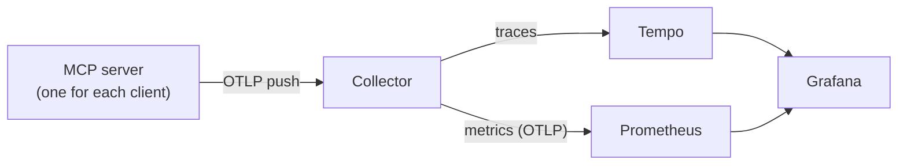

# Telemetry

The server can export traces and metrics over OpenTelemetry (OTLP). It is **off by default**: with no setting, no
telemetry package does work and no data leaves the process.

The decisions are in `Docs/Architecture.md`, "Telemetry is optional, and goes through a Collector". The measurements
are in `Docs/Research/OpenTelemetry-Findings.md`.

## What it is for

Telemetry is an **opt-in diagnostics feature** that ships in every build. It answers questions about how the server
behaves over time (ex. how long a tool takes, and how often it fails). It is not needed to use the tools.

| You are | Telemetry | What to do |
| --- | --- | --- |
| A user who runs the tools | Not needed | Do nothing. It stays off. |
| Someone who finds a problem in one session | Not needed | Read the logs. See "Telemetry and the logs". |
| A developer or admin who measures the server over days or across many users | Useful | Set an endpoint, and run a viewer. See "Turn it on and off". |

**The server only sends data. It stores nothing.** Each server is a short-lived process with no port, and it keeps no
copy of what it sends. With an endpoint set and nothing that listens at it, the data is lost. To see it or to keep it,
a program must receive it. That program is a *backend*:

| Backend | What you get | Kept |
| --- | --- | --- |
| None | Nothing | No |
| An OTLP viewer, ex. the Aspire dashboard | A live look at traces and metrics | Often in memory only |
| The stack in `Tools/Telemetry` (Collector, Prometheus, Tempo, Grafana) | The "Inventor MCP" dashboard, and a trace for each call | 90 days, on disk |

In the stack, Prometheus keeps the metrics, Tempo keeps the traces, and Grafana shows both. Docker is optional: Step A
runs the same programs as plain Windows executables, and Step B runs them in containers.



## Telemetry and the logs

Telemetry does not replace the logs, and it does not change them. Every log file in `README.md`, "Logs", is written
with or without telemetry. Telemetry has one effect on the logs: with it on, each line of `server-<date>.log` that is
written during a tool call ends with the trace ID, so a line leads to its trace in Tempo.

| | Logs | Telemetry |
| --- | --- | --- |
| State | Always on | Off until you set an endpoint |
| Answers | What happened in one session, in detail (ex. the code of a snippet, a dialog text) | How the server behaves in all sessions (ex. the p95 duration of each tool) |
| Contents | Can hold paths, code and dialog text | Fixed tags only. See "What is sent". |
| Stays | On this machine | Goes to the endpoint you set |

## What it answers

| Question | Where |
| --- | --- |
| How long does each tool take, and how often does it fail? By tool, error, release and client. | Dashboard row 1 |
| How much of an `inventor_eval_csharp` call is Inventor's main thread, and how much is wait? | Dashboard row 2 |
| Which skills are read, and is `interop` read before the first snippet of a session? | Dashboard row 3 |
| How many servers are connected to each Inventor release, against the limit of 16? | Dashboard row 4 |
| How often does the server answer a dialog, and which dialog type? | Dashboard row 5 |
| Which sick features does `inventor_health` find after calls that worked? | Dashboard row 6 |

## Turn it on and off

These are the standard OpenTelemetry variables. Set them in the `env` of the server's entry in the MCP client. Only the
endpoint is needed.

| Variable | Needed | Default | What it does |
| --- | --- | --- | --- |
| `OTEL_EXPORTER_OTLP_ENDPOINT` | Yes | Not set | The address that receives the data (ex. `http://127.0.0.1:4317`). **It is the on switch**: not set or empty, telemetry is off. |
| `OTEL_SDK_DISABLED` | No | Not set | `true` turns telemetry off, also with an endpoint. Use it to turn telemetry off and keep the endpoint in the entry. |
| `OTEL_EXPORTER_OTLP_PROTOCOL` | No | `grpc` | `grpc` (port 4317 of the Collector) or `http/protobuf` (port 4318). Use the port that fits the protocol. |
| `OTEL_EXPORTER_OTLP_TIMEOUT` | No | 500 ms, set by the server | The time one export can take. The SDK's own default is 10 s, and with no backend the server then took 6 to 15 s to end. With 500, it ends within 2 s. |
| `OTEL_METRIC_EXPORT_INTERVAL` | No | 10000 ms, set by the server | The time between metric exports. The SDK's own default is 60 s. A client can end the server with no warning, and the data since the last export is lost, so the server uses less. |
| `OTEL_RESOURCE_ATTRIBUTES` | No | Not set | Adds your own resource attributes (ex. a team name). The Collector removes them. A viewer with no Collector keeps them. |

The server reads the variables when it starts, so reconnect the client after a change.

Add the endpoint to the `env` of the server's entry in each MCP client, after the values in `README.md`, "Connecting a
client". Then reconnect the client (in Claude Code, `/mcp` and Reconnect).

```json
"env": {
	"DOTNET_NOLOGO": "1",
	"DOTNET_CLI_TELEMETRY_OPTOUT": "1",
	"OTEL_EXPORTER_OTLP_ENDPOINT": "http://127.0.0.1:4317"
}
```

- Write `127.0.0.1`, not `localhost`. The programs listen on IPv4 only, and with `localhost` the server sent nothing.
- For Claude Code, run `claude mcp remove autodesk-inventor-mcp-server -s user`, then add the entry again with the
	new `env`. Claude Code passes the `OTEL_*` values of an entry's own `env` to the server.
- Claude Desktop, Visual Studio and Visual Studio Code: add the same line to `env` in the files that `README.md` names.
- The server log says which state it started in: "Telemetry on, endpoint ..." or "Telemetry off.". With telemetry on,
	each line written during a tool call ends with the trace ID, so a line leads to its trace in Tempo.

To turn it off, remove the line, or set `OTEL_SDK_DISABLED` to `true`, and reconnect.

## What is sent

Two guards remove every other value. The server removes each span tag that is not on its allowlist
(`Source/InventorMcp.Server/Telemetry/TelemetryTags.cs`) before the export, and each metric keeps only the allowed
tags. The Collector (Steps A and B) applies the same list again. A unit test fails when the two lists differ.

| Kind | Keys |
| --- | --- |
| Resource | `service.name` (`InventorMcp.Server`), `service.version`, `service.instance.id` (one for each server process), `telemetry.sdk.*` |
| The server's tags | `gen_ai.tool.name`, `inventor.outcome`, `error.type`, `inventor.release`, `inventor.release.selection`, `inventor.client.name`, `inventor.bridge.operation`, `inventor.skill.name`, `inventor.dialog.type`, `inventor.dialog.action`, `inventor.health.status` |
| The MCP library's tags | `gen_ai.operation.name`, `mcp.method.name`, `mcp.protocol.version`, `network.transport`, `rpc.response.status_code`, `jsonrpc.protocol.version`, and on spans only `mcp.session.id` and `jsonrpc.request.id` |

The values are a fixed kind:

| Tag | Values |
| --- | --- |
| `inventor.outcome` | `ok`, `bridge-error` (the bridge or Inventor failed), `code-failed` (a snippet threw or did not compile), `tool-error` (the tool refused the call itself, ex. `invalid-arguments`), `exception` |
| `error.type` | A bridge error code (ex. `inventor-not-running`), an error code of a tool (ex. `invalid-arguments`), a .NET or Inventor exception type (ex. `System.Runtime.InteropServices.COMException`), `compilation-error`, `tool_error`, or `other` for any other name |
| `inventor.release` | `2025`, `2026`, `2027`, or `none` with no connection |
| `inventor.client.name` | The client name and version from `initialize` (ex. `claude-code 2.1.312`), cut to 64 characters |
| `inventor.skill.name` | A skill name from the catalog, never the argument of the call |
| `inventor.dialog.type` | A dialog type of the catalog (ex. `iLogicError`), or `none` |
| `inventor.dialog.action` | `clicked`, `closed-elsewhere`, `click-failed`, `needs-person` |
| `inventor.health.status` | A health status from the add-in (ex. `DriverLost`, `InError`), or `other` |

Never sent:

| Value | Why |
| --- | --- |
| Snippet text, iLogic rule text, tool arguments and results | They can hold client names, paths and parameter values. |
| File names, document names, paths, `mcp.resource.uri` | Client data and user paths. |
| Dialog titles and text | A rule or an add-in writes any text. |
| Exception messages, and the span status text | They can hold a path. The library puts the result of a failed call in the status text, so it is removed. |
| An exception type that a snippet or a plugin declares | Its name can hold client data. It is sent as `other`. |
| A tool, method or prompt name that the server does not have | The client writes it, and the MCP library puts it in the span name. The span is named from known values (ex. `tools/call other`), and the Collector checks the form of each name again. |
| Machine name, user name, `host.*`, `process.*` | The server adds no host or process resource detector. |
| Logs | A log line can hold a dialog text or a path. Only the trace ID links the file log to a trace. |

The server sends to the endpoint that the user sets, and to nothing else. Every program of the stack below listens on
`127.0.0.1` only, so nothing leaves the machine. `OTEL_RESOURCE_ATTRIBUTES` can add resource attributes on the server
side. The Collector removes them. A viewer that takes OTLP with no Collector (see "Other viewers") does not.

## Install the programs

Step A runs the programs by hand. Download each one into its own folder under
`%LOCALAPPDATA%\InventorMcp\Telemetry\programs`, and compare each file with the checksum that the project publishes.
`Start-TelemetryStack.ps1` finds each executable anywhere under that folder.

| Program | Version tested | Download | Executable |
| --- | --- | --- | --- |
| OpenTelemetry Collector, contrib build | 0.164.0 | `otelcol-contrib_<version>_windows_amd64.tar.gz` from github.com/open-telemetry/opentelemetry-collector-releases/releases | `otelcol-contrib.exe` |
| Prometheus | 3.15.1 | `prometheus-<version>.windows-amd64.zip` from github.com/prometheus/prometheus/releases | `prometheus.exe` |
| Tempo | 3.1.1 | `tempo_<version>_windows_amd64.tar.gz` from github.com/grafana/tempo/releases | `tempo.exe` |
| Grafana OSS | 13.3.0 | `grafana-<version>.windows-amd64.zip` from grafana.com/grafana/download?platform=windows (about 500 MB) | `bin\grafana.exe` |

Windows extracts a `.tar.gz` with `tar -xzf <file> -C <folder>`. No program needs administrator rights, and none is
installed as a service.

## Step A: the stack, started by hand

One Collector receives the data of every server, applies the second guard, and sends it to Tempo (traces on disk) and
to Prometheus (metrics on disk, over OTLP). Grafana shows the history. OTLP gives each counter its start time, so
Prometheus counts the first call of a new server process. A Prometheus scrape has no start time, and lost most calls
of short sessions.

```powershell
.\Tools\Telemetry\Start-TelemetryStack.ps1
```

Then set `OTEL_EXPORTER_OTLP_ENDPOINT` to `http://127.0.0.1:4317` in the client entry, and reconnect.
`.\Tools\Telemetry\Stop-TelemetryStack.ps1` stops all four programs. A program that already runs is not started again.

| Program | Port | Use |
| --- | --- | --- |
| Collector | 4317 (gRPC), 4318 (HTTP) | OTLP from the servers |
| Tempo | 4417 | OTLP gRPC from the Collector. Not 4317, which the Collector uses. |
| Tempo | 3200, 9095 | API for Grafana, and Tempo's own gRPC |
| Prometheus | 9090 | UI and API for Grafana, and OTLP HTTP from the Collector (`/api/v1/otlp`) |
| Grafana | 3000 | UI, with no login |

The ports are in one place for each program: `otel-collector.yaml`, `tempo.yaml`, and `Start-TelemetryStack.ps1` for
Prometheus and Grafana. To change a port that is in use, change it there and in the files that send to it.

| Data | Folder | Kept |
| --- | --- | --- |
| Prometheus | `%LOCALAPPDATA%\InventorMcp\Telemetry\prometheus` | 90 days |
| Tempo | `%LOCALAPPDATA%\InventorMcp\Telemetry\tempo` | 90 days |
| Grafana | `%LOCALAPPDATA%\InventorMcp\Telemetry\grafana` | Its settings only |
| Program logs | `%LOCALAPPDATA%\InventorMcp\Telemetry\logs` | Replaced at each start |

Prometheus needs three options, which `Start-TelemetryStack.ps1` and Compose give: `--web.enable-otlp-receiver`, and
the features `created-timestamp-zero-ingestion` (a 0 at the start time of each counter) and
`promql-extended-range-selectors` (the `anchored` ranges of the dashboard). `prometheus.yaml` puts `service.version`
on each metric. The connection panel counts a server for 1 minute after its last export, so with an
`OTEL_METRIC_EXPORT_INTERVAL` above 60000 a connected server shows gaps.

## Step B: Docker Compose

The same stack in containers, with each image at an exact version and the data in named volumes.

```
cd Tools\Telemetry\compose
docker compose up -d
```

Podman reads the same file (`podman compose up -d`). Docker Desktop can need a paid license in a company. The ports
are the same as Step A, and only 4317, 4318, 9090 and 3000 are published, on `127.0.0.1`. Grafana mounts the
provisioning and dashboard files of Step A, so there is one copy of each. The Collector, Prometheus and Tempo have their
own file in `compose/`, because their addresses are service names there.

This step was not run on a machine with Docker. Each image tag was checked in its registry.

## Delete the data

Stop the stack, then delete the folders of the table in Step A. For Step B, run `docker compose down -v`, which
deletes the named volumes.

## Read the dashboard

Grafana loads the dashboard "Inventor MCP" from `Tools/Telemetry/grafana/dashboards/inventor-mcp.json`. The time
range at the top sets the range of each count.

| Row | Panel | How to read it |
| --- | --- | --- |
| 1 | Calls by tool | Calls each second. |
| 1 | Failed calls by tool | The part of the calls with an outcome that is not `ok`. A `bridge-error` is often expected (ex. `inventor-not-running` while Inventor starts). |
| 1 | Failures by outcome and error type | Which errors happen most. `code-failed` is a snippet that threw or did not compile. |
| 1 | Duration p50 and p95 by tool | A point with a marker is an exemplar: click it to open that call's trace in Tempo. |
| 1 | Calls above 10 s by tool | Calls longer than the limit of the server instructions. A long snippet can terminate Inventor. |
| 1 | Calls by version, client and release | Which clients use which release, and how two server versions compare. |
| 2 | main thread against the whole call | The gap between the two lines is the wait: behind calls of other servers, to open a document, and the bridge. |
| 2 | Bridge queue wait | The wait behind an earlier call of the same server. |
| 3 | Skill reads | The total of each skill. |
| 3 | Skill reads and snippets, by session | Each `service.instance.id` is one session. Sort by it and by the start time to see whether `interop` came before the first `inventor_eval_csharp`. |
| 4 | Connected servers by release | Against the dashed line at 16, the connections that the add-in admits for each release. |
| 5 | Dialogs by type and action | `clicked`: the server answered it. `needs-person`: it stayed open for the user. A failed click counts as `click-failed` and then `needs-person`. |
| 5 | Slow snippets | Traces of `inventor_eval_csharp` longer than 5 s. |
| 6 | Sick features by status | Sick features that each `inventor_health` call reported, suppressed ones left out. A call that worked can leave a wrong model, ex. a hole that cut nothing gives `DriverLost`, and its outcome is still `ok`. The same feature counts again at each read. |

A count over the time range uses `increase(...[$__range] anchored)`, which gives whole numbers with no extrapolation
to the ends of the range. A panel that shows a rate each second (ex. "Calls by tool") is an estimate.

The MCP library records `mcp.server.operation.duration` too, but the server does not export it: it has the tool and
the method name as the client wrote them. `inventor.tool.duration` gives the same durations.

## Other viewers

The server sends standard OTLP, so any OTLP viewer can take the data for a quick live look, ex. the Aspire dashboard.
Point `OTEL_EXPORTER_OTLP_ENDPOINT` at it. With no Collector, only the server's guard applies, and such a viewer
often keeps the data in memory only. The repository supports only the stack above. Aspire was removed from it,
because Grafana, Prometheus and Tempo show the same data and keep it. See `Docs/Research/OpenTelemetry-Findings.md`,
"Aspire was removed".

Claude Code can export its own traces (`CLAUDE_CODE_ENABLE_TELEMETRY=1`, `CLAUDE_CODE_ENHANCED_TELEMETRY_BETA=1`,
`OTEL_TRACES_EXPORTER=otlp`). It sends no trace context to a stdio server, so its spans and the server's spans are
separate traces. Do not send them to this Collector: its allowlist removes every attribute that the server does not
send. Their attributes can hold prompts and tool input, so send them only to a viewer that keeps the data on this
machine.
