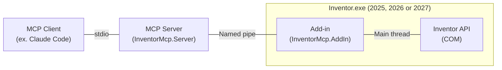

# Autodesk Inventor MCP Server


[](https://dotnet.microsoft.com/en-us/download/dotnet/10.0)
[](LICENSE)
[](Directory.Build.props)

An MCP server that lets Claude inspect and drive a live Autodesk Inventor session, 2025 through 2027.
It is built for developing Inventor plugins and automation, so Claude can see what a running automation loop creates, in order, as it runs.



## Documentation

- **[Setup and Usage Guide](Docs/Setup-and-Usage-Guide.md)** - install, connect Claude, what to ask for, troubleshooting, logs
- **[Connecting a Client](Docs/Connecting-a-Client.md)** - the entry for Claude Code, Claude Desktop, Visual Studio and Visual Studio Code
- **[Starting Inventor and Releases](Docs/Inventor-Releases.md)** - start Inventor from Claude, and use Inventor 2025, 2026 and 2027 together
- **[Tools and Code Execution](Docs/Tools.md)** - every tool, the safeguards on code execution, and how to limit what a model can do
- **[Dialog Settings](Docs/Dialog-Settings.md)** - how the server answers each Inventor dialog that blocks a call
- **[Plugin Development Loop](Docs/Plugin-Development-Loop.md)** - run and iterate on a plugin in a live session
- **[Telemetry](Docs/Telemetry.md)** - optional traces and metrics, off by default
- **[Development](Docs/Development.md)** - how it is built, the projects, and debugging the add-in
- **[Architecture](Docs/Architecture.md)** - the decisions and the reasons for them
- **[Security](SECURITY.md)** - what the server protects, and what it does not
- **[Changelog](CHANGELOG.md)**

## Quick start

Requirements: the .NET 10 SDK, and Autodesk Inventor 2025, 2026 or 2027 to run. Inventor is not needed to build.

**1. Build, and install the add-in** for each Inventor release that you use:

```
dotnet build InventorMcp.slnx
dotnet build Source/InventorMcp.AddIn/InventorMcp.AddIn.csproj -p:AutodeskVersion=2027 -p:DeployAddIn=true
```

`AutodeskVersion` is 2025, 2026 or 2027, and defaults to 2027. Restart Inventor, then check that
`%LOCALAPPDATA%\InventorMcp\2027\addin.log` says the bridge started.
`Docs/Setup-and-Usage-Guide.md`, "Install", has the release style install and what to do when the add-in does not load.

**2. Connect a client.** The client starts the server, so there is nothing to leave running. For Claude Code:

```
claude mcp add-json autodesk-inventor-mcp-server -s user '{"type":"stdio","command":"dotnet","args":["tool","exec","InventorMcp.Server","--prerelease","--source","${LOCALAPPDATA}/InventorMcp/Feed","--yes"],"env":{"DOTNET_NOLOGO":"1","DOTNET_CLI_TELEMETRY_OPTOUT":"1"}}'
```

This is the setup for working on the server: it starts the server from `%LOCALAPPDATA%\InventorMcp\Feed`, which each
Debug build fills. `Docs/Connecting-a-Client.md` has the setup for a team feed, and the entry for the other clients.

**3. Ask Claude about your Inventor session.** If Inventor is closed, Claude asks before it starts it.

## Learn more

- Inventor must be open with the add-in loaded. With Inventor closed, the server still starts and every tool returns a
  readable `inventor-not-running` result. See `Docs/Inventor-Releases.md`.
- A number with no unit is in centimeters and radians in the API, in the document's units in iLogic `Parameter()`,
  and in the parameter's units in an expression. See `Docs/Tools.md`.
- To limit a model to read-only tools, set `INVENTORMCP_TOOLS=read-only` in the `env` of the client entry.
  See `Docs/Tools.md`, "Limit what a model can do".
- `AGENTS.md` and `.agents/rules/` are for coding agents that work on this repository.
